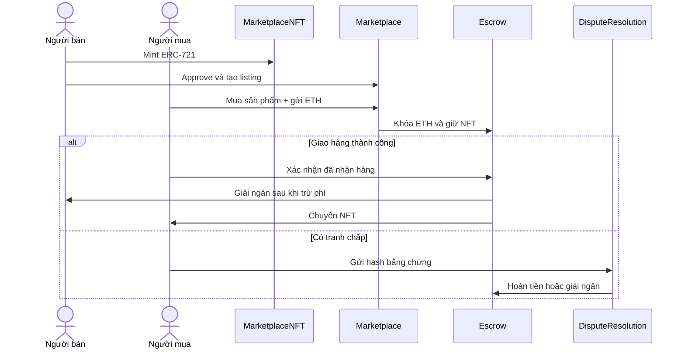

# TrustChain — NFT Marketplace với Smart-Contract Escrow

TrustChain là đồ án blockchain mô phỏng một chợ mua bán sản phẩm vật lý. Smart contract quản lý chứng nhận ERC-721, listing, thanh toán ký quỹ, tranh chấp và uy tín; ứng dụng web quản lý tài khoản, hồ sơ và dữ liệu sản phẩm ngoài chuỗi.

> **Trạng thái hiện tại:** web đã kết nối ví và gọi smart contract cho luồng IPFS → mint NFT → đăng bán → mua qua Escrow → giải ngân/hoàn tiền/phân xử. Indexer đồng bộ sự kiện thật vào PostgreSQL. Đã cấu hình pipeline local và Sepolia; deployment công khai cần RPC, ví và ETH testnet của nhóm. Xem [hướng dẫn blockchain](docs/BLOCKCHAIN_SETUP.md).

[](https://soliditylang.org/)
[](https://hardhat.org/)
[](https://nextjs.org/)
[](https://www.postgresql.org/)


## Blockchain được dùng ở đâu?



Các quy tắc trên được thực thi trong EVM, không phụ thuộc vào giao diện:

- `MarketplaceNFT`: mint chứng nhận sản phẩm ERC-721 và ghi metadata URI.
- `Marketplace`: tạo/hủy listing, kiểm tra giá và chuyển giao dịch mua vào escrow.
- `Escrow`: giữ ETH và NFT, giải ngân, hoàn tiền, timeout và đóng băng khi tranh chấp.
- `FeeManager`: tính phí giao thức; cấu hình mô phỏng hiện dùng 250 bps (2,5%).
- `DisputeResolution`: ghi hash bằng chứng và chỉ cho địa chỉ có `ARBITRATOR_ROLE` ra phán quyết.
- `Reputation`: chỉ cập nhật uy tín từ giao dịch hoặc phán quyết đã được xác minh.

Mã nguồn nằm trong [`packages/contracts/contracts`](packages/contracts/contracts). Cấu hình Hardhat chính tại [`hardhat.config.js`](hardhat.config.js) chỉ build và test bộ contract này.

## Bằng chứng smart contract đang hoạt động

Chạy:

```powershell
npm.cmd install
npm.cmd run compile
npm.cmd test
npm.cmd run simulate:trustchain
```

Kết quả đã xác minh tại local:

- **29 test passing** cho mint NFT, listing, escrow, hoàn tiền, timeout, tranh chấp, reputation và các trường hợp thiếu quyền/approval/ownership.
- Mô phỏng triển khai 6 contract trên blockchain Hardhat tạm thời.
- Alice mint NFT và đăng bán với giá `1.5 ETH`.
- Bob mua; `1.5 ETH` và NFT được khóa trong `Escrow`.
- Khi Bob xác nhận giao hàng, Alice nhận `1.4625 ETH`, treasury nhận `0.0375 ETH`, NFT chuyển cho Bob.
- Reputation của người mua và người bán được cập nhật từ giao dịch đã hoàn tất.

Mỗi lần chạy `simulate:trustchain`, Hardhat tạo một blockchain in-memory mới. Địa chỉ contract và trạng thái sẽ được đặt lại sau khi tiến trình kết thúc; đây là môi trường minh họa, chưa phải testnet công khai.

## Dữ liệu on-chain và off-chain

| Dữ liệu | Nơi lưu hiện tại | Lý do |
|---|---|---|
| Chủ sở hữu NFT, listing, giá bán | Smart contract | Cần kiểm chứng và không được sửa tùy ý |
| ETH đang ký quỹ, trạng thái giải ngân | Smart contract | Các bên không cần tin máy chủ web giữ tiền |
| Hash bằng chứng tranh chấp | Smart contract | Chứng minh bằng chứng tồn tại tại một thời điểm |
| Uy tín từ giao dịch hoàn tất | Smart contract | Hạn chế tự tạo đánh giá giả |
| Email, mật khẩu hash, số điện thoại | PostgreSQL | Không đưa dữ liệu cá nhân lên blockchain công khai |
| Hồ sơ, địa chỉ, mô tả và bộ lọc sản phẩm | PostgreSQL | Dễ cập nhật và tìm kiếm, không tốn gas |
| Metadata NFT | IPFS Kubo trong Docker | Snapshot nội dung công khai, CID được ghi trong NFT |
| Ảnh sản phẩm blockchain | IPFS, URI trong metadata | Upload ảnh, chuẩn hóa WebP và bỏ EXIF/GPS trước khi pin |
| Events, NFT, listing, order, dispute | Bản sao có checkpoint trong PostgreSQL | Tra cứu nhanh, có thể phát lại từ blockchain |

Blockchain không tự chứng minh món hàng vật lý là hàng thật. Nó chứng minh lịch sử của chứng nhận số, quyền sở hữu và việc thanh toán tuân theo smart contract. Độ tin cậy ban đầu vẫn phụ thuộc bên phát hành chứng nhận và quy trình xác minh sản phẩm.

## Chạy ứng dụng web

Yêu cầu:

- Node.js 22 trở lên.
- Docker Desktop đang chạy.

Từ thư mục gốc:

```powershell
npm.cmd run dev:marketplace
```

Lệnh này:

1. Khởi động PostgreSQL, Mailpit và IPFS bằng Docker.
2. Tạo/cập nhật cấu hình local và Prisma Client.
3. Đồng bộ schema của web.
4. Chạy Next.js tại http://localhost:3000.

Các địa chỉ local:

- Web: http://localhost:3000/vi
- Mailpit: http://localhost:8025
- PostgreSQL: `localhost:5432`

Hướng dẫn chi tiết:

- [Chạy marketplace local](docs/MARKETPLACE_LOCAL.md)
- [Đăng ký, xác thực email và OAuth](docs/AUTH_SETUP.md)
- [Kết nối ví, deploy contract, IPFS, Escrow và indexer](docs/BLOCKCHAIN_SETUP.md)
- [Ảnh IPFS, kiểm tra CID, sao lưu và khôi phục CAR](docs/IPFS_STORAGE.md)
- [Kiến trúc thực thi và sơ đồ](docs/ARCHITECTURE.md)
- [Báo cáo học thuật](docs/WHITE_PAPER.md), [gas thực đo](docs/GAS_REPORT.md), [kết quả kiểm thử](docs/TEST_REPORT.md)
- [Kịch bản và ghi video demo](docs/DEMO_GUIDE.md), [checklist nộp bài](docs/SUBMISSION_CHECKLIST.md)

## Những gì web đã làm được

- Đăng ký và đăng nhập bằng email hoặc số điện thoại.
- Xác thực email và đặt lại mật khẩu qua Mailpit.
- Cấu hình tùy chọn cho Google và Facebook OAuth.
- Hồ sơ/shop công khai, avatar và chỉnh sửa hồ sơ.
- Tạo, xem và lọc mặt hàng lưu trong PostgreSQL.
- Giao diện tiếng Việt/tiếng Anh và responsive.
- Giới hạn quyền truy cập hồ sơ, sản phẩm và trang quản trị.
- Liên kết ví bằng chữ ký một lần, kiểm tra đúng chain/deployment.
- Quản lý kết nối ví ngay trong menu tài khoản; đăng xuất sẽ yêu cầu MetaMask ngắt quyền của website nhưng vẫn giữ liên kết ví–tài khoản.
- Lưu bản nháp, upload ảnh và ghim metadata IPFS, mint/approve/list từ ví người bán.
- Kiểm tra CID, cấu hình node pin dự phòng, sao lưu/khôi phục IPFS bằng CAR.
- Mua bán Escrow, giải ngân, hoàn tiền, timeout và phân xử bằng giao dịch thật.
- Kho NFT, đơn hàng, xác minh và phân xử đọc dữ liệu thật; giao dịch testnet có link explorer.
- Indexer có journal, checkpoint, chống trùng, retry và phục hồi reorg cơ bản.

## Giới hạn hiện tại

- Chưa triển khai Sepolia bằng ví của nhóm; cần điền cấu hình theo hướng dẫn.
- Chưa kiểm chứng extension MetaMask thật; UI test sử dụng adapter EIP-1193 ký giao dịch thật trên Hardhat.
- Hardhat local mất trạng thái khi tắt node. Mỗi lần khởi động chain mới cần deploy lại.
- IPFS local cần node/pin còn hoạt động; chưa có dịch vụ pin ảnh và metadata công khai lâu dài.
- Dữ liệu nhạy cảm nằm ngoài chuỗi nhưng chưa có lớp mã hóa ứng dụng riêng cho địa chỉ giao hàng.
- Phân xử vẫn có quyền owner/arbitrator tập trung theo contract hiện có. Chưa thực hiện audit bảo mật độc lập.

Vì vậy, UI không nên tuyên bố một mặt hàng “đã được NFT xác minh” hoặc “được escrow bảo vệ” nếu bản ghi chưa có `chainId`, địa chỉ contract, `tokenId` và transaction hash tương ứng.

## Chạy blockchain cùng web

Chạy `npm.cmd run node` trong terminal riêng, rồi `npm.cmd run deploy:local`. Khởi động web bằng `npm.cmd run dev:marketplace`, và worker trong terminal khác bằng `npm.cmd run indexer`. Trình tự, ví demo, quyền trọng tài và cấu hình Sepolia được mô tả tại [BLOCKCHAIN_SETUP.md](docs/BLOCKCHAIN_SETUP.md).

Chọn **Đăng bán blockchain** trên form để đi qua IPFS/NFT/Escrow. Đăng tin thông thường vẫn được hỗ trợ nhưng không được gắn nhãn là giao dịch on-chain.

## Kiểm tra web

Khi PostgreSQL, Mailpit và web đang chạy:

```powershell
npm.cmd run typecheck --prefix apps/web
npm.cmd run test:auth --prefix apps/web
npm.cmd run test:chain --prefix apps/web
npm.cmd run test:ipfs --prefix apps/web
npm.cmd run test:ui --prefix apps/web
```

## Cấu trúc repository

```text
BlockChain/
├── apps/web/                      # Next.js, NextAuth, Prisma và giao diện marketplace
├── packages/contracts/
│   ├── contracts/                # Bộ smart contract TrustChain đang được Hardhat build
│   ├── test/                     # 29 kiểm thử smart contract
│   └── scripts/                  # Deploy và mô phỏng marketplace
├── prisma/schema.prisma          # Schema backend mở rộng, chưa phải schema runtime của web
├── apps/web/prisma/schema.prisma # Schema PostgreSQL mà web đang sử dụng
├── contracts/                    # Prototype nghiên cứu AegisMed, không thuộc Hardhat build chính
├── docs/                         # Kiến trúc, báo cáo, gas, kiểm thử, demo; bản cũ ở archive/
├── docker-compose.yml            # PostgreSQL + Mailpit + IPFS
├── hardhat.config.js             # Cấu hình TrustChain contracts/tests
└── package.json                  # Script cấp repository
```

## Ghi chú về AegisMed

Thư mục [`contracts`](contracts) và tài liệu trong [`docs/archive`](docs/archive/README.md) là prototype/blueprint nghiên cứu trước đây, gồm truy xuất dược phẩm, Merkle proof và cold-chain oracle. Prototype này được giữ lại để tham khảo nhưng **không được biên dịch hoặc kiểm thử bởi cấu hình Hardhat chính hiện tại**. `docs/ARCHITECTURE.md` và `docs/WHITE_PAPER.md` hiện mô tả TrustChain thực tế.

Nếu tiếp tục AegisMed, cần tách thành workspace/cấu hình Hardhat riêng và không trộn tuyên bố của AegisMed với sản phẩm TrustChain.

## Mục tiêu học thuật

TrustChain dùng blockchain tại những nơi cần giảm sự phụ thuộc vào máy chủ trung tâm:

- Quyền sở hữu chứng nhận số.
- Quy tắc listing và mua bán.
- Ký quỹ tài sản.
- Phán quyết tranh chấp có kiểm soát quyền.
- Uy tín chỉ hình thành từ giao dịch đã xác minh.

PostgreSQL vẫn được dùng cho dữ liệu riêng tư và truy vấn ứng dụng. Thiết kế hybrid này tránh đưa thông tin cá nhân lên blockchain và tránh trả gas cho dữ liệu không cần đồng thuận công khai.

## License

MIT License.
