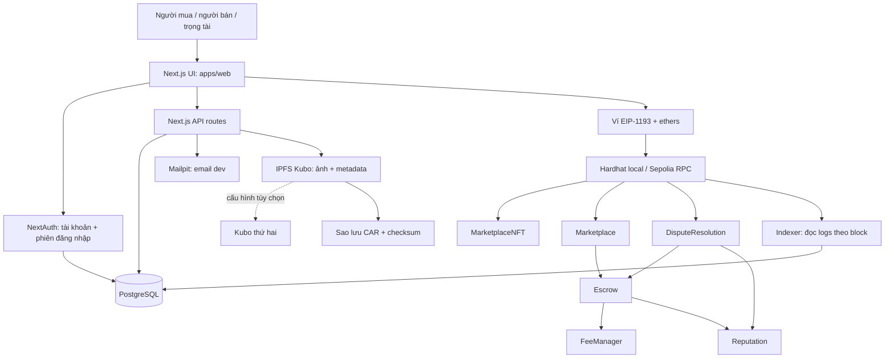
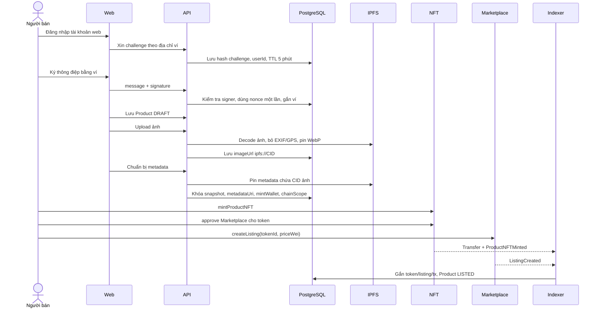
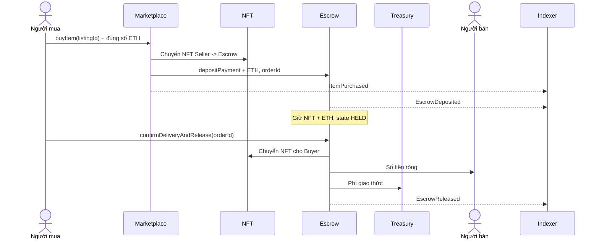
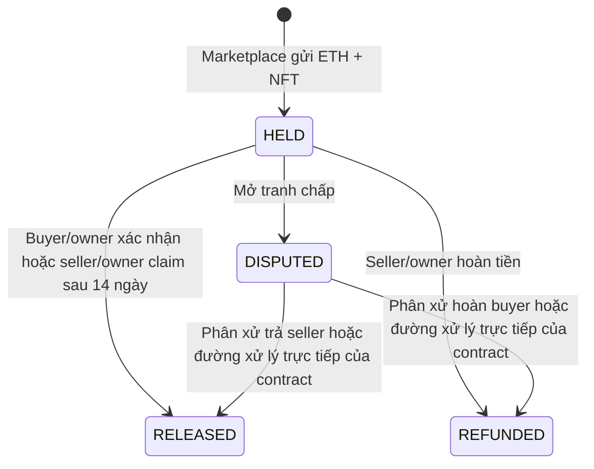
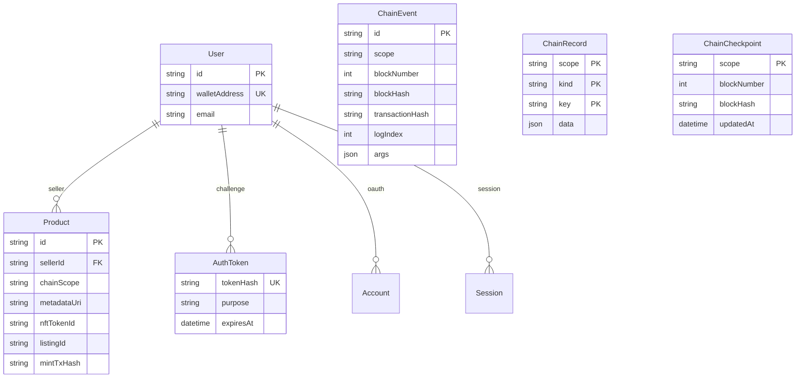

# Kiến trúc thực thi TrustChain

Tài liệu mô tả code đang có, không phải cam kết production. Cập nhật 12/10/2026. Prototype AegisMed và các bản thiết kế cũ được giữ ở [archive](archive/README.md).

## 1. Thành phần đang chạy

| Thành phần | Nguồn mã | Trách nhiệm |
|---|---|---|
| Frontend | `apps/web/src/app/[locale]`, `components` | UI sáng/tối, EN/VI, ký giao dịch bằng ví |
| Backend runtime | `apps/web/src/app/api` | Tài khoản, kiểm tra chủ sản phẩm, upload IPFS, trả dữ liệu |
| Schema runtime | `apps/web/prisma/schema.prisma` | User, Product, AuthToken, ChainEvent, ChainRecord, ChainCheckpoint |
| Contract | `packages/contracts/contracts` | Quyền sở hữu số, listing, thanh toán và phân xử |
| Đồng bộ | `apps/web/src/lib/chain/indexer.cjs`, `apps/indexer/worker.cjs` | Journal sự kiện, projection và checkpoint |
| IPFS | `apps/web/src/lib/ipfs.cjs` | Pin, tính lại CID bằng importer, giới hạn nội dung đọc, replica tùy chọn |
| Prototype ngoài luồng chính | `apps/api`, schema root, `contracts/` | Không dùng để chứng minh runtime web hiện tại |

Không có Redis, oracle giao hàng, vận chuyển tích hợp, mã hóa địa chỉ cấp ứng dụng hoặc SIWE login chuẩn trong runtime này. Email/mật khẩu vẫn là phương thức đăng nhập; chữ ký ví dùng để **liên kết ví vào phiên đã đăng nhập**. Google/Facebook chỉ hoạt động khi cấu hình OAuth riêng.

## 2. Ranh giới on-chain/off-chain

| Thông tin | Nguồn sự thật | Lý do |
|---|---|---|
| `ownerOf`, `tokenURI`, approvals | MarketplaceNFT | Kiểm chứng quyền sở hữu và quyền chuyển token |
| Listing, giá wei, trạng thái mua | Marketplace | Áp dụng điều kiện bán và thanh toán |
| ETH và NFT ký quỹ, release/refund | Escrow | Chuyển tài sản theo điều kiện contract |
| Hash bằng chứng, ruling, arbitrator | DisputeResolution | Lưu dấu vết và kiểm tra role |
| Chỉ số giao dịch/uy tín | Reputation | Caller có quyền cập nhật theo giao dịch |
| Ảnh chuẩn hóa + metadata công khai | IPFS | Định danh nội dung bằng CID, giảm dữ liệu on-chain |
| Email, hash mật khẩu, địa chỉ, phiên, nonce | PostgreSQL | Quyền riêng tư và nghiệp vụ tài khoản |
| Catalog, bản nháp, bản sao events | PostgreSQL | Tìm kiếm nhanh; projection chain có thể dựng lại |
| Bằng chứng gốc | Máy người dùng / kênh riêng với trọng tài | Không tự đưa chứng cứ cá nhân lên IPFS công khai |

NFT không chứng minh sản phẩm vật lý là chính hãng hoặc đã giao. IPFS không tự bảo đảm nội dung còn mãi. Uy tín gắn giao dịch không loại bỏ việc một người điều khiển nhiều ví.

## 3. Liên kết ví và đăng bán

API không giữ private key người dùng. Server không tin `tokenId` hay tx hash do client tự khai. Khi gắn sản phẩm vào NFT, indexer yêu cầu metadata URI, người nhận mint và người gửi tx khớp ví đã liên kết. Snapshot khóa chỉnh sửa sau pin; đây là lựa chọn bảo toàn tính nhất quán, kể cả người dùng dừng trước mint.

## 4. Mua và giải ngân

Giá là wei nguyên; UI chuyển từ ETH bằng `parseEther`. Tx mua và chuyển NFT vào Escrow là nguyên tử: nếu thiếu approve hoặc không còn sở hữu token, cả giao dịch revert. UI lấy `orderId` từ receipt của địa chỉ Marketplace đang cấu hình.

14 ngày tính từ lúc ký quỹ, không từ chứng nhận hãng vận chuyển. Không có trạng thái SHIPPED hay oracle theo dõi giao hàng trong contract.

## 5. Phân xử

Người mua/người bán chọn file, trình duyệt tính keccak256. `DisputeResolution.openDispute` ghi hash và gọi Escrow đóng băng trạng thái. `submitEvidence` cập nhật hash của bên tương ứng. Ví có `ARBITRATOR_ROLE` đánh dấu xem xét và ra ruling. Web ADMIN chỉ mở màn hình; quyền chuyển tài sản do contract kiểm tra riêng.

Contract hiện vẫn cho owner và một số bên giao dịch giải quyết Escrow trực tiếp, kể cả DISPUTED. Hồ sơ DisputeResolution có thể còn OPEN khi Escrow đã được xử lý theo đường khác. UI cảnh báo trường hợp này. Nhóm phải trình bày đây là **mô hình phân xử có quản trị**, chưa phải DAO độc lập hoàn toàn.

## 6. Schema và đồng bộ

`scope` gồm chain ID, Marketplace address và hash block deploy để phân biệt lần deploy/reset. Ba bảng Chain dùng scope logic, không có foreign key cưỡng chế tới Product; đừng vẽ quan hệ SQL không tồn tại. `ChainRecord.kind` là nft/listing/order/dispute/reputation.

Indexer kiểm tra chain ID/block deploy, giữ advisory lock, đọc từ checkpoint đến head trừ confirmation depth theo batch 500 block. Events và projection cùng commit với checkpoint. Lỗi giữa batch rollback tất cả. ID event gồm scope/txHash/logIndex ngăn trùng. Checkpoint đổi hash thì replay riêng deployment từ block đầu. Reorg trong khi đọc cũng làm batch rollback.

Giới hạn: cơ chế replay toàn deployment phù hợp đồ án, chưa tối ưu chain lớn; API snapshot chưa phân trang; confirmation depth không phải bảo đảm finality tuyệt đối. RPC và node pin vẫn là hạ tầng cần tin cậy/vận hành.

## 7. API và route kiểm chứng

| API / route | Tác dụng |
|---|---|
| `POST /api/chain/wallet` | Challenge và kiểm tra chữ ký liên kết |
| `POST /api/products` | DRAFT blockchain hoặc tin thông thường |
| `POST /api/products/:id/image` | Upload ảnh có kiểm tra chủ sở hữu, pin IPFS |
| `POST /api/products/:id/metadata` | Pin snapshot, khóa chỉnh sửa |
| `GET /api/ipfs/:cid` | Đọc ảnh có giới hạn, kiểm tra CID và kiểu raster |
| `GET /api/chain` | Manifest công khai, checkpoint, projection |
| `POST /api/chain/sync` | Yêu cầu đồng bộ, có phiên và rate limit |
| `GET /api/chain/verify/:id` | Đọc owner/tokenURI tại một block, kiểm tra nội dung metadata |
| `/vi/nfts`, `/vi/orders/:id`, `/vi/admin` | Tài sản, giao dịch, phân xử thật |

Tham chiếu chuẩn: [ERC-721](https://eips.ethereum.org/EIPS/eip-721) cho ownership/approval/tokenURI; [EIP-1193](https://eips.ethereum.org/EIPS/eip-1193) cho giao diện ví. Chi tiết thực thi phải đối chiếu source của repository, không suy ra từ các chuẩn rằng sản phẩm đã có mọi chức năng tùy chọn.
